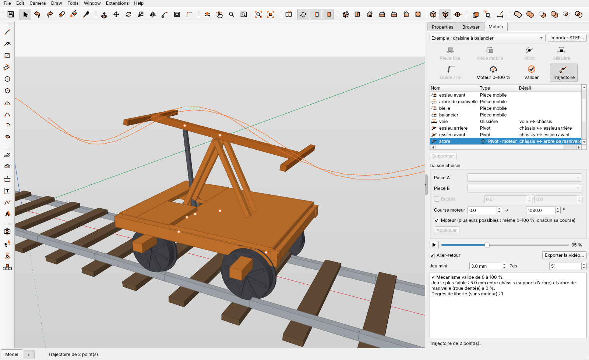

# Motion — mechanisms for IngeTrazo

Kinematic validation of simple furniture and building mechanisms: drop-leaf,
drawer, folding chair, sectional garage door. Define the parts and joints on
your model, play the motion with a slider, and check it: collisions, joint
stops and the minimum clearance between parts.

*Validation cinématique de mécanismes simples (abattant, tiroir, chaise
pliante, porte sectionnelle) : pièces et liaisons définies sur le modèle,
lecture au curseur, contrôle des collisions, des butées et du jeu minimal.*

Clean-room, from scratch, GPL-3.0-or-later. Pure Python + numpy core, tested
against closed-form results.



## Install

IngeTrazo ▸ Extensions ▸ Manage extensions… ▸ **Motion**, or unzip
`dist/motion-<version>.zip` into the plugins folder (`%APPDATA%\ingetrazo\plugins`),
which gives `plugins\motion\__init__.py`. Restart IngeTrazo; the **Motion**
tab appears in the side tray, and Extensions ▸ Motion has the examples.

## Language

Motion follows IngeTrazo's language (Window ▸ Language): French when
IngeTrazo is in French, English otherwise. `MOTION_LANG=fr` or `en` forces
one.

## Use

| Icon | Select first | Result |
|---|---|---|
| Fixed part | one or more groups | they form the frame |
| Moving part | one or more groups | they move together |
| Pivot | ONE edge or construction line on the axis | hinge between the two nearest parts |
| Slider | ONE edge along the travel | slide between the two nearest parts |
| Pivot glissant | ONE edge on the axis | turns and slides |
| Rotule | edges around the joint centre (a small circle) | ball joint |
| Encastrement | edges at the joint point | the two parts move as one |
| Élastique | edges at the joint point | silent-block (springs in the dynamics) |
| Linéaire annulaire | ONE edge on the bore's axis + a circle of the ball | ball sliding in a bore, every rotation free |
| Ponctuelle | ONE edge along the normal, from the contact point | point on a plane |
| Appui plan | ONE edge along the plane's normal | slides on the plane, turns about the normal |
| Hélicoïdale | ONE edge on the axis, then the pitch (mm per turn) | screw and nut |
| Guide/rail | the rail's edges (lines + arc segments) and a short stroke across the rail at each roller | one roller joint per stroke, on the nearest moving part |
| Driver 0–100 % | a joint in the list, and its travel (° or mm) | that joint drives the motion |
| Validate | — | 0 → 100 %: convergence, collisions, stops, gaps under *Jeu mini* |
| Trajectory | edges whose end points to trace (else the joint points) | dashed paths in the view |

**Several motors**: tick «Moteur» on as many joints as needed; all run on
the same 0–100 %, each over its own travel (speed) from its own start
(phase).

**Détecter…** scans the parts (the selection, or the whole model) and
proposes the joints — shafts in bores (pivots), flat guides (sliders),
meshing gears (ratio from the teeth), separate pins kept with the part they
are pressed in — with the frame; tick the ones to keep, they are created in
one undo step. Then pick a motor.

The sixteen tools sit in one 4×4 grid: parts and pivot/slider, the other
standard joints (two rows), then rail, motor, validation, trajectory.

**Collisions on the real surfaces**: on a model, every part is checked by
its faces, not its box (a casing does not swallow what it holds): points
spread over the faces, then the exact signed distance to the triangles
where they come close. What touches in the drawn position is the joint (a
pin in its bore); meshing gears are not checked against each other; a
penetration under 0.1 mm (faceting) is not a collision. On any joint: ressort, amortisseur, moteur en couple. Tick **Dynamique** (and a
duration) to run your model in time: weight, springs, dampers, stops; the
report gives the motors' torques.

**Matériau**: pick the material of the part chosen in the list (woods,
metals, plastics; «Nouveau…» for your own); its mass, volume and centre of
gravity follow, the centres are drawn in the view and the masses listed in
the validation report — the ground for the dynamics to come.

**Importer STEP…** brings a STEP assembly (AP203/214/242) into the model,
one group per part, named and coloured, in one undo step — then select
groups to make them fixed or moving parts.

**Exporter la vidéo…** (under the playback slider) writes a split-screen
video: the IngeTrazo view on the left, a shaded animation with the readings
on the right. MP4 needs an encoder: Qt Multimedia if your IngeTrazo has it,
else `ffmpeg` (found on the PATH, or point to `ffmpeg.exe` once in the
dialog); without either, the video is saved as AVI (Motion-JPEG).

The animation is drawn over the model: the groups themselves do not move,
so playing adds no undo steps. The mechanism is saved in the `.igz`; every
edit is one undo step. Collision boxes are fitted to each group.

## What the core does

- Rigid bodies with 6-parameter poses; pivot, slider and guide/rail
  (a point on a path of lines and circular arcs) with optional stops;
  coupling (gears, rolling without slip, rack and pinion).
- Levenberg–Marquardt position solver for open chains and closed loops;
  degrees of freedom from the constraint Jacobian's rank.
- Oriented boxes: separating-axis interference, **exact** box-to-box
  distance (vertex/box and edge/edge), minimum-clearance check along the
  motion. Box pairs of joined parts that already touch when drawn are the
  joint; the rest of the two parts is still checked.
- Dynamics: weight, inertia, joint friction, speed or torque motors, joint
  reactions and motor torques (Newton-Euler, Runge-Kutta 4), checked
  against pendulum periods, free fall and power balance.
- Examples: folding chair with crossed legs, sectional door (any number of
  panels, two tracks), flapping bird (crank, slider, two-segment wings),
  hand-pumped rail car (beam, rod, gears, rolling axles), roller chain with a
  hanging slack strand and a tensioner.
- Roller chain: straight tight strand, slack strand as a catenary of the exact
  length left, links as parts that seat in the sprocket teeth, sag readout;
  optional dynamics (weight, inertia, damping) for a supple slack strand in
  videos and playback — the first step towards a dynamic Motion.

## Tests

```
python tests/test_core.py        # V0.1: drop-leaf, drawer, four-bar
python tests/test_chair.py       # folding chair vs closed forms
python tests/test_clearance.py   # exact distances, gaps along a motion
python tests/test_guide.py       # rail, trammel ellipse, sectional door
python tests/test_bird.py        # flapping bird over a full crank turn
python tests/test_coupling.py    # gears over several turns, rolling without slip
python tests/test_handcar.py     # rail car over three crank turns
python tests/test_multidriver.py # two motors, speed and phase
python tests/test_chain.py       # chain: pitch, tangency, catenary, teeth, tensioner
python tests/test_detect.py      # automatic joints on independent STEP assemblies
python tests/test_mass.py        # masses and inertia vs closed forms and OpenCascade
python tests/test_dynamics.py    # free fall, pendulums, slope, flywheel, motor torque
python tests/test_joints.py      # cylindrical, ball, lock, elastic, springs, stops
python tests/test_stepread.py    # STEP reader vs an independent CAD kernel
python tests/test_document.py    # what the panel stores
python tests/test_video.py       # video writers (AVI checked byte by byte)
python tests/test_panel_ingetrazo.py   # the panel in a real IngeTrazo
                                       # window (needs PySide6 and an
                                       # IngeTrazo checkout: INGETRAZO_SRC)
```
STEP fixtures: `tests/data/` (regenerate with `tools/make_step_fixtures.py` and
`tools/make_detect_fixtures.py`, `tools/make_mass_fixtures.py`,
which needs CadQuery — a test-data tool only, nothing of it is shipped).
All are pytest-compatible. Build the package: `python tools/build_zip.py`
(prints the sha256 for `catalog/motion.toml`).

## Licence

GPL-3.0-or-later — see `LICENSE`.
